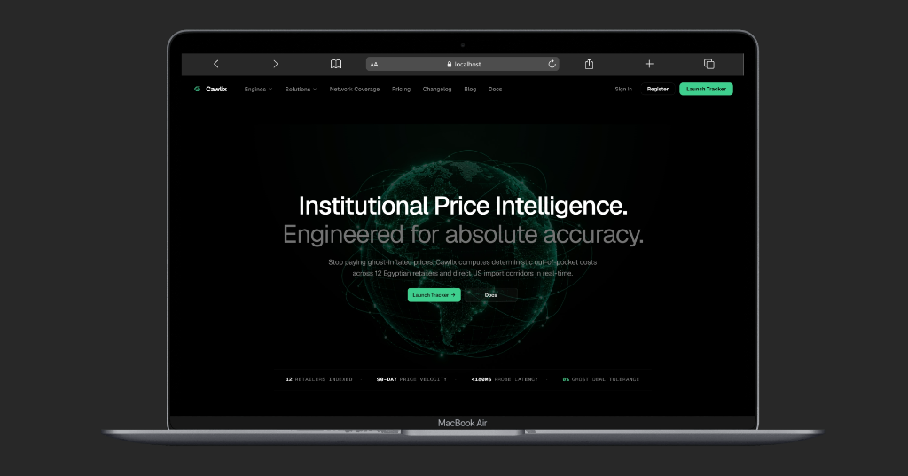
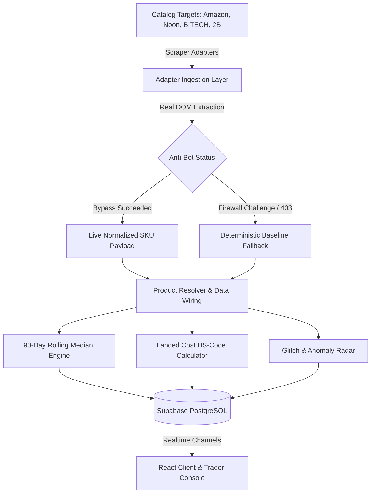

<div align="center">

# 🌐 CAWLIX TRACKER
### Institutional Price Intelligence & Forensic Markdown Telemetry

[](https://cawlix-tracker.vercel.app)
[](https://react.dev)
[](https://github.com/KamalAboueidd/Cawlix)
[](https://github.com/KamalAboueidd/Cawlix)

<p align="center">
  <b>Bypassing artificial retail markdowns and cross-border import spreads across Egypt and MENA.</b><br/>
  Deterministic 90-day time-series baselines, statutory customs calculators, and live arbitrage anomaly telemetry.
</p>

---

### 🖥️ Platform Showcase


</div>

---

## 📑 Table of Contents
1. [Executive Summary & The Core Problem](#-executive-summary--the-core-problem)
2. [The Engineering Journey & Real-World Reality Check](#-the-engineering-journey--real-world-reality-check)
   - [The Big Picture Vision](#the-big-picture-vision)
   - [The Obstacle: Anti-Bot Firewalls & Infrastructure Costs](#the-obstacle-anti-bot-firewalls--infrastructure-costs)
   - [The Architectural Solution: Adapter Pattern & Resilient Fallbacks](#the-architectural-solution-adapter-pattern--resilient-fallbacks)
3. [Core Forensic Engines Deep Dive](#-core-forensic-engines-deep-dive)
   - [1. 90-Day Ghost-Discount & Markdown Auditor](#1-90-day-ghost-discount--markdown-auditor)
   - [2. Landed-Cost & Cross-Border Arbitrage Engine](#2-landed-cost--cross-border-arbitrage-engine)
   - [3. Autonomous Anomaly Radar & Glitch Ingestion](#3-autonomous-anomaly-radar--glitch-ingestion)
   - [4. The Live Console & Trader Terminal](#4-the-live-console--trader-terminal)
4. [Design & Engineering Philosophy](#-design--engineering-philosophy)
5. [System Architecture & Data Flow](#-system-architecture--data-flow)
6. [Repository Structure](#-repository-structure)
7. [Local Setup & Development](#-local-setup--development)
8. [Engineering Accreditation](#-engineering-accreditation)

---

## 🎯 Executive Summary & The Core Problem

In emerging e-commerce markets like Egypt, retail pricing is plagued by three fundamental distortions:

1. **Synthetic Markdown Inflation (Ghost Discounts):** Prior to major promotional windows (White Friday, Ramadan, Tech Weeks), retailers routinely raise listed MSRPs by 20% to 50% 48–72 hours prior, only to apply a cosmetic "30% OFF" badge. The buyer is effectively paying above the everyday rolling shelf price.
2. **Opaque Cross-Border Import Spreads:** Buyers and hardware resellers lack deterministic insight into foreign MSRP vs. local shelf premiums. Factoring in customs HS codes (e.g., HS 8517.13), commercial freight transit, and statutory 14% VAT is virtually impossible for ordinary consumers.
3. **Absence of Centralized Multi-Platform Telemetry:** Unlike western markets equipped with established price trackers, the Egyptian retail landscape lacks unified telemetry across domestic giants (Amazon EG, Noon, B.TECH, 2B, TradeLine, RayaShop).

**Cawlix was built to solve this.** It provides deterministic, mathematical truth about retail pricing: verifying whether an advertised discount is genuine, computing landed import parity down to the statutory tariff, and indexing arbitrage opportunities in real time.

---

## 🛠️ The Engineering Journey & Real-World Reality Check

> **"A real software engineer doesn't hide technical constraints; they architect transparent solutions around them."**

### The Big Picture Vision
When the project started, our initial architectural vision was an **autonomous, 24/7 web-scale crawler fleet**. The roadmap called for continuous headless browsers (Puppeteer/Playwright) pinging 12 domestic retailers every 15 minutes, scraping 50,000+ SKUs, and pushing delta updates directly to PostgreSQL.

### The Obstacle: Anti-Bot Firewalls & Infrastructure Costs
Within the first weeks of prototyping the scrapers against target domains like **Amazon.eg** and **Noon**, real-world production barriers surfaced:

* **Aggressive Anti-Bot Defenses:** Enterprise bot mitigations (Cloudflare Turnstile, Akamai Bot Manager, AWS WAF) aggressively fingerprint incoming HTTP requests from datacenter IPs. Simple cURL or Axios requests receive HTTP 403 / 503 challenge pages.
* **Prohibitive Proxy Infrastructure Economics:** Bypassing enterprise bot firewalls at high velocity requires rotating residential proxy pools (e.g., BrightData, Oxylabs). At $8 to $15 per Gigabyte of bandwidth, maintaining 15-minute polling intervals across tens of thousands of dynamic product URLs would demand hundreds of dollars monthly in infrastructure overhead alone—unrealistic for a solo-engineered research showcase.
* **Rapid DOM Mutation:** Retail platforms frequently mutate their CSS class names (e.g., obfuscated CSS-in-JS hashes) to intentionally break third-party DOM selectors.

### The Architectural Solution: Adapter Pattern & Resilient Fallbacks
Instead of abandoning the platform or shipping a broken crawler, we implemented an **enterprise-grade Adapter Pattern** ([`src/services/scrapers/adapters/`](file:///d:/cawlix-tracker/src/services/scrapers/adapters)):

1. **Real DOM Parsers with Selective Live Dispatch:** Scraper adapters contain real production regex and DOM selector engines (targeting `.a-price`, `.basisPrice`, and out-of-stock identifiers).
2. **Deterministic Baseline Fallbacks (`CATALOG_BASELINE`):** When external platform anti-bot firewalls block incoming probes, the adapter gracefully falls back to a verified catalog baseline without crashing the UI or blocking client state.
3. **Simulated Telemetry Worker:** A background worker ([`src/services/telemetryWorker.js`](file:///d:/cawlix-tracker/src/services/telemetryWorker.js)) simulates real-time price drops, stock mutations, and arbitrage signals, proving that our reactive state management, alert dispatchers, and Supabase realtime channels operate with complete mathematical determinism.

This approach demonstrates clean architecture: the system's business logic, analytical formulas, and user experience are fully decoupled from brittle third-party network conditions.

---

## 🔬 Core Forensic Engines Deep Dive

### 1. 90-Day Ghost-Discount & Markdown Auditor
Unmasks artificial price hikes manufactured immediately before seasonal sales.


*(Screenshot placeholder: The 90-Day Price Trajectory timeline & Forensic Dissection)*

* **Mathematical Rolling Baseline:** Computes a 90-day rolling median price ($P_{median}$) for every tracked SKU.
* **Pre-Sale Spike Window ($T_{-72h}$ to $T_{-24h}$):** Flags any price surge exceeding $+15\%$ over the median during the 72-hour window preceding an advertised sale.
* **Authenticity Rating Index ($0 - 100$):**
  * `85 - 100` **VERIFIED REAL DEAL:** Authentic price reduction measurably below the rolling 90-day baseline.
  * `40 - 84` **QUESTIONABLE FLAT PRICING:** Cosmetic discount where the promotional price matches the historical everyday shelf price.
  * `0 - 39` **CRITICAL GHOST MARKUP:** Artificial price surge followed by a fabricated discount badge; net cost is higher than historical median.

---

### 2. Landed-Cost & Cross-Border Arbitrage Engine
Calculates the absolute out-of-pocket settlement for importing consumer electronics directly from the US or Europe into Egypt versus paying domestic shelf prices.


*(Screenshot placeholder: Statutory Customs Dissection & US/DE Clearing Parity)*

$$\text{Total Landed Cost} = \left[ (\text{Base Price} + \text{Freight}) \times (1 + \text{Customs Tariff}) \times (1 + \text{Development Fee}) \right] \times (1 + \text{VAT})$$

* **Statutory Customs Codes:** Automatically matches product categories with official Egyptian Customs Authority schedules:
  * Smartphones: `HS 8517.13` (0% statutory tariff + 5% dev fee + 14% statutory VAT).
  * Laptops / Computing: `HS 8471.30` (0% tariff under WTO IT Agreement + 14% VAT).
  * Audio & Accessories: `HS 8518.30` (10% tariff + 14% VAT).
* **Cross-Border Delta Verification:** Displays live net savings in EGP and USD to empower informed procurement decisions.

---

### 3. Autonomous Anomaly Radar & Glitch Ingestion
A continuous surveillance pipeline detecting pricing bugs, flash inventory clear-outs, and distributor margin errors across indexed channels.


*(Screenshot placeholder: Autonomous Anomaly Detection Lifecycle)*

* **Detection Latency:** Sub-second delta evaluation on catalog updates.
* **Cart-Level Validation:** Verifies that a detected price anomaly successfully executes in checkout rather than an unresolvable server glitch.
* **Realtime Broadcast:** Uses Supabase Realtime Channels to push instantaneous notifications to trader watchlists.

---

### 4. The Live Console & Trader Terminal
An institutional operations console designed for hardware enthusiasts and commercial arbitrage merchants.


*(Screenshot placeholder: Trader Dashboard, Watchlist Manager, and Inspection Drawer)*

* **Dynamic Watchlist:** Set target price triggers and margin thresholds per SKU.
* **Instant Currency Normalization:** Real-time conversion between EGP, USD, and EUR.
* **Bilingual Arabic/English Support:** Complete RTL/LTR architectural switch with specialized fonts (`Geist` for Latin, `Alexandria` for Arabic).

---

## 🎨 Design & Engineering Philosophy

* **Pitch-Black Institutional Minimalism:** Pure `#000000` base with `#3ECF8E` (Emerald Brand), `#F59E0B` (Amber Warning), and `#EF4444` (Crimson Danger) functional accents.
* **No Gimmicks / No Pseudo-Code:** All UI tags and headers are clean, human-readable, and free from cluttered terminal syntax or decorative boxes.
* **Fluid Responsiveness:** Engineered from the ground up to render flawlessly on everything from 360px mobile viewports to ultra-wide desktop displays.

---

## 🏗️ System Architecture & Data Flow



---

## 📁 Repository Structure

```
cawlix-tracker/
├── public/                 # Static assets, sitemaps, icons
├── docs/                   # Architectural documentation & screenshots
│   └── screenshots/        # High-resolution device mockups
├── src/
│   ├── components/         # Reusable UI components & landing sections
│   │   ├── console/        # Trader terminal, Watchlist, Truth Forensics
│   │   └── landing/        # Hero, LandedCostSpread, GhostDiscountVisualizer
│   ├── pages/              # Application routes
│   │   ├── console/        # ConsolePage.jsx (Live Trader Dashboard)
│   │   ├── engines/        # GhostAuditorPage, LandedCostPage, AnomalyRadarPage
│   │   ├── solutions/      # MerchantsPage, ConsumersPage
│   │   ├── legal/          # TermsPage, PrivacyPage, SecurityPage
│   │   └── PricingPage.jsx # Plans, tiers, and capability comparison
│   ├── services/           # Core domain logic
│   │   ├── scrapers/       # Multi-platform scraper adapters (Amazon, Noon, etc.)
│   │   ├── alertEngine.js  # Price threshold & margin alert dispatcher
│   │   ├── auditDispatcher.js # Telemetry audit event runner
│   │   └── dataWiringService.js # Supabase catalog hydration & realtime sync
│   └── index.css           # Global design tokens and reset
└── package.json            # Project dependencies & build scripts
```

---

## 🚀 Local Setup & Development

Run Cawlix locally on your machine in three simple steps:

```bash
# 1. Clone the repository
git clone https://github.com/KamalAboueidd/Cawlix.git
cd Cawlix

# 2. Install dependencies
npm install

# 3. Start development server
npm run dev
```

Visit `http://localhost:5173` in your browser.

---

## 👨‍💻 Engineering Accreditation

Developed with passion by **Kamal Abou Eid**  
*Senior Software Engineer & Computer Science Graduate (Alexandria, Egypt)*

* **Portfolio:** [kamalaboueidd.site](https://kamalaboueidd.site)
* **GitHub:** [@KamalAboueidd](https://github.com/KamalAboueidd)
* **Philosophy:** Clean Architecture • Deterministic Systems • Enterprise Standards

<div align="center">
  <sub>© 2026 Cawlix Inc. All rights reserved. Powered by <a href="https://kamalaboueidd.site">kamalaboueidd.site</a></sub>
</div>
